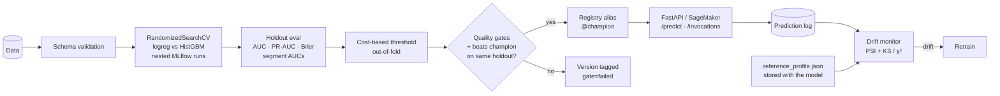

# MLOps Pipeline: churn model from training to drift alert

A complete lifecycle for a production classifier: **validated data → hyperparameter
search tracked in MLflow → quality gates → model registry with a `champion` alias → FastAPI
/ SageMaker serving → prediction logging → statistical drift monitoring → retrain signal**.
CI runs every stage.



## Results on the bundled dataset

Synthetic churn data with known ground truth, 20k rows:

| Metric | Value |
|---|---|
| ROC-AUC (holdout) | 0.80 |
| PR-AUC | 0.54 (base rate ≈ 0.24) |
| Brier score | 0.144 |
| Decision threshold | 0.17, chosen to minimise expected cost with FN = 5 × FP |
| Recall / precision at that threshold | 0.86 / 0.40 |

**Segment check:** AUC is 0.79 on two-year contracts but only **0.69 on month-to-month**,
which is the segment that churns most. An overall AUC would hide this, so segment AUCs are
logged on every run.

Logistic regression edged out gradient boosting in cross-validation. That's expected, since
the generator is logistic. The pipeline picks whichever candidate wins instead of assuming the
fancier model.

## Engineering decisions

- **The threshold is a business decision, not 0.5.** It's picked by minimising expected cost
  on **out-of-fold** training predictions. In-sample scores are over-confident, and tuning on
  the test set would leak the holdout.
- **Promotion is compared on the same holdout.** The current champion is re-scored on the
  challenger's holdout before the regression gate runs. Comparing metrics logged on different
  splits is a classic mistake.
- **The drift reference travels with the model.** `reference_profile.json` (quantile bins,
  category shares, a reference sample, and the training score distribution) is logged in the
  model's run. The monitor always compares production traffic against the data the serving
  model actually saw.
- **"Drift" needs effect size and significance.** PSI ≥ 0.25 *and* p < 0.01 (KS for numeric,
  χ² for categorical). With large samples, a p-value alone flags trivial shifts, so effect size
  is required too. Prediction drift and unseen categories are reported separately.
- **Serialization is safe by default.** MLflow 3 stores sklearn models with skops, which
  refuses unreviewed types when loading. The one type HistGradientBoosting needs is
  allow-listed explicitly, rather than trusting everything.
- **One image serves both targets.** The same container serves `/predict` for local and app
  use, and `/ping` + `/invocations` for SageMaker (JSON or CSV), with input validated by
  Pydantic and the schema.

## Run it

```bash
pip install -e ".[dev,aws]"
export MLFLOW_DISABLE_AGENT_HINT=1

python -m mlops.train --rows 20000 --n-iter 15        # exit 3 if the gates reject the model
mlflow ui --backend-store-uri sqlite:///mlflow.db     # browse runs, metrics, registry

MODEL_URI=models:/churn-classifier@champion PREDICTION_LOG=predictions.jsonl \
  uvicorn mlops.serve:app_factory --factory --port 8080

python -m mlops.simulate --rows 2000                                   # normal traffic
python -m mlops.simulate --rows 2000 --price-increase 25 --m2m-share 0.75   # price-rise scenario
python -m mlops.monitor --log predictions.jsonl --last 2000            # exit 2 on drift; writes reports/
```

```bash
curl -s localhost:8080/predict -H 'content-type: application/json' -d '{"records":[{
  "tenure_months": 3, "monthly_charges": 95, "support_tickets": 4, "usage_gb": 12,
  "contract": "month-to-month", "payment_method": "e-check", "region": "west", "has_partner": "no"}]}'
```

## Deploy to SageMaker

```bash
docker build -t churn-serve . && docker push <ecr-uri>/churn-serve:latest
python -m mlops.sagemaker_deploy --image <ecr-uri>/churn-serve:latest \
  --bucket <artifact-bucket> --role arn:aws:iam::<acct>:role/SageMakerExecution
```

The deploy script packages `@champion` as `model.tar.gz` and turns on data capture (a 20%
sample to S3). The first deploy creates the endpoint. Later deploys do a **blue/green canary**
that sends 10% of traffic for 10 minutes, with **automatic rollback** on a 5xx CloudWatch
alarm.

## CI

`.github/workflows/ml.yml` has three jobs:

- `test`: lint plus 14 tests, including a full train → reject a bad challenger → serve → detect
  drift run against a throwaway registry.
- `train-and-gate`: trains on every push to `main` and fails if the gates reject the model.
- `drift-monitor`: a daily job that raises a retraining warning and uploads the HTML drift
  report.

## Layout

```
mlops/
  data.py              synthetic generator with covariate/concept drift knobs; schema validation
  modeling.py          preprocessing, candidate search spaces, cost threshold, metrics, slices
  train.py             training CLI: nested runs, gates, registry + alias promotion
  drift.py             profiling, PSI, KS/χ², HTML report
  serve.py             FastAPI server (local + SageMaker contract), prediction log, Prometheus
  monitor.py           drift CLI with CI-friendly exit codes
  simulate.py          traffic generator (normal or drifted)
  sagemaker_deploy.py  package, register, canary deploy with auto-rollback
```
